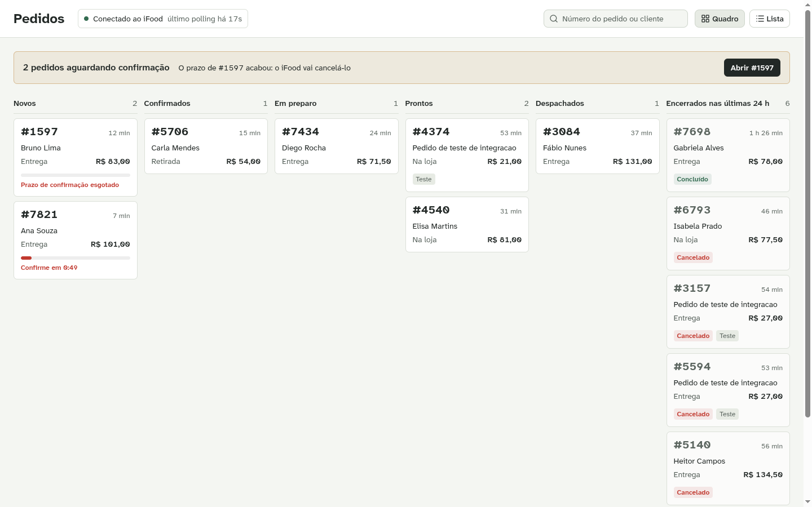
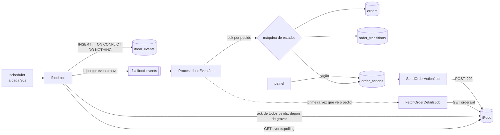
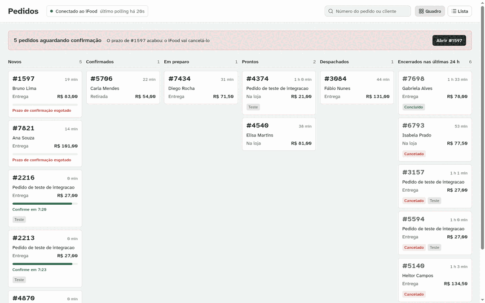

# iFood Orders

Integração em Laravel com a API de pedidos do iFood (Merchant API, módulo Order), com um painel de operação para acompanhar e mover os pedidos.

O foco não é ser um PDV, e sim mostrar como tratar o que dá errado numa integração assíncrona: eventos duplicados, fora de ordem ou atrasados, ações que o iFood aceita e depois ignora, `404` logo após o pedido, rate limit, falhas de rede e workers que morrem no meio do caminho.

Tudo foi validado contra a **API real**, com o app e a loja de teste da conta de desenvolvedor. O que a documentação pública dizia e a API não fazia está registrado em [`docs/discovery.md`](docs/discovery.md).



## Para avaliar em 15 minutos

1. `make setup`, depois `make demo` → abra http://localhost:8000. Não precisa de credenciais.
2. Abra o pedido de **Fábio Nunes**, na coluna "Despachados". Os eventos chegaram fora de ordem e a linha do tempo mostra quais foram ignorados e por quê.
3. Abra um pedido em **Novos**. A barra mostra quanto falta para o iFood cancelar o pedido por falta de confirmação.
4. Leia [`app/Ifood/Orders/OrderStateMachine.php`](app/Ifood/Orders/OrderStateMachine.php) e [`app/Ifood/Events/EventIngestor.php`](app/Ifood/Events/EventIngestor.php): são as duas peças centrais, com poucas linhas cada.
5. `make test` roda 146 testes, em [`tests/Feature/Ifood`](tests/Feature/Ifood) e [`tests/Unit`](tests/Unit).

## Como rodar

Pré-requisitos: Docker e `make`.

```bash
make setup     # cria o .env, sobe os containers, instala dependências, migra e compila o front
make demo      # opcional: pedidos de exemplo, sem precisar do iFood
```

Para usar a API real, preencha `IFOOD_CLIENT_ID`, `IFOOD_CLIENT_SECRET` e `IFOOD_MERCHANT_ID` no `.env` (app de teste, fluxo centralizado). O scheduler começa a fazer polling sozinho, e os pedidos gerados pelo botão "Generate orders" do portal aparecem no painel em até 30 segundos.

| Comando | O que faz |
|---|---|
| `make up` / `make down` | Sobe ou derruba app, Horizon, scheduler, Postgres e Redis |
| `make dev` | O mesmo, com o Vite em modo de desenvolvimento |
| `make ci` | Pint, PHPStan (nível 9) e Pest, igual ao GitHub Actions |
| `make poll` | Roda um ciclo de polling manualmente |
| `make reload` | Recarrega workers e scheduler depois de mudar o código |
| `make logs s=horizon` | Logs de um serviço. Os logs da integração ficam em `storage/logs/ifood-*.log`, em JSON |

Horizon em http://localhost:8000/horizon.

## Como funciona



1. **Entrada.** O `ifood:poll` grava os eventos com `INSERT … ON CONFLICT (event_id) DO NOTHING RETURNING`: quem decide o que é novo é o banco. Depois envia um job por evento novo e faz o ack de **todos** os IDs recebidos, inclusive os repetidos. Se a gravação falhar, nenhum ack é enviado.
2. **Processamento.** Eventos do mesmo pedido nunca rodam em paralelo (`WithoutOverlapping` por pedido, mais `lockForUpdate`). A máquina de estados decide se o evento muda o pedido, e cada evento gera uma linha em `order_transitions`, aplicada ou não, com o motivo.
3. **Ações.** O iFood responde `202` e só confirma depois, por evento. A ação fica aberta até o evento correspondente chegar, até um CARF ou até expirar.

## Como cada falha é tratada

| Situação | O que acontece | Teste |
|---|---|---|
| Evento duplicado (no mesmo lote ou reentregue) | Gravado uma vez pelo índice único; ack refeito | `EventIngestionTest` |
| Fora de ordem (CFM antes do PLC, DSP antes do CFM) | O status é decidido por **rank**: o maior status visto vence, seja qual for a ordem de chegada. O PLC atrasado ainda define `placed_at` e o prazo | `OrderLifecycleTest`, `OrderStateMachineTest` |
| Atrasado (CFM depois de CAN) | Estados terminais não reabrem; o evento fica como `ignored` / `order_terminal` | `OrderLifecycleTest` |
| Código desconhecido (DDCR, visto na API real) | Gravado e confirmado com ack, mas não aplicado; nunca trava a fila | `ProcessIfoodEventJobTest` |
| CAR ou CARF antes do pedido existir | O job espera o evento de status, sem gastar tentativa | `OrderLifecycleTest` |
| `404` nos detalhes logo após o PLC | Backoff de 5s, 10s, 20s… por até 10 minutos, depois `details_error` | `FetchOrderDetailsJobTest` |
| `429` | Uma trava compartilhada no Redis faz todos os workers pararem até o reset; os jobs usam `release()` sem gastar tentativa | `IfoodClientTest` |
| `401` | Token descartado e renovado, com uma única nova tentativa | `IfoodClientTest` |
| `5xx` ou rede | Retry na hora; depois, retry do job com backoff; depois `failed` + `ifood:retry` com backoff exponencial | `IfoodClientTest`, `ProcessIfoodEventJobTest` |
| Ack falhou | O ciclo segue; o iFood reentrega, a gravação ignora e o ack é refeito | `EventIngestionTest` |
| Worker morreu entre gravar e processar | O `ifood:retry` recupera eventos `received` parados há mais de 2 minutos | `ProcessIfoodEventJobTest` |
| Clique duplo numa ação | Índice único parcial: no máximo uma ação aberta por pedido | `OrderActionsTest` |
| Ação aceita com 202 e depois ignorada (visto na API real) | Expira em 2 minutos e o painel avisa | `OrderActionsTest` |
| CARF (cancelamento recusado) | A ação falha com o motivo e o pedido não muda | `OrderActionsTest` |
| iFood cancela enquanto a confirmação está pendente | A ação falha com "pedido cancelado antes da confirmação" | `OrderActionsTest` |

## Fluxo real, de ponta a ponta

Três pedidos gerados no portal do iFood e movidos pelo painel: `#2216` foi confirmado, preparado, marcado como pronto e despachado; `#2213` foi cancelado pela loja, com o motivo escolhido na lista que o iFood devolve para aquele pedido; e `#4870` ficou sem ação, até o iFood cancelá-lo sozinho 8 minutos depois do PLC. Cada ação respondeu `202` e foi fechada pelo evento real correspondente, entre 5 e 30 segundos depois (o intervalo do polling). Os horários estão em [`docs/discovery.md`](docs/discovery.md#ações-pelo-sistema-validação-de-ponta-a-ponta).



## O que a API real mostrou

Algumas diferenças em relação à documentação pública. A lista completa, com exemplos, está em [`docs/discovery.md`](docs/discovery.md).

- O polling é `GET /order/v1.0/events:polling`. O path `orders:polling` dá 404.
- O ack recebe uma lista `[{"id": …}]`. O formato `{"acknowledgedEventIds": […]}` dá 400.
- O cancelamento exige `cancellationCode`; só `reason` dá 400.
- Toda ação usa POST e responde 202, **inclusive ações inválidas**, que depois somem sem evento nenhum.
- O `dispatch` é aceito direto de CONFIRMED, por isso a máquina de estados não exige a sequência passo a passo.
- Pode chegar CAN sem CAR antes.
- Pedidos de totem (`DINE_IN`) chegam confirmados automaticamente.
- O ack chegou a levar 5,5 s.
- A API tem três formatos de corpo de erro.

## Decisões

- **Polling em vez de webhook.** É o que o app de teste oferece sem expor um endpoint público, e obriga a tratar ack e reentrega. O webhook está em "Evolução".
- **Rank em vez de timestamp.** Os status do iFood só avançam, então a ordem de chegada não importa. Comparar `createdAt` erraria quando dois eventos chegam no mesmo milissegundo ou com relógios diferentes.
- **Idempotência no banco**, não no código: o índice único em `event_id` e em `order_transitions.ifood_event_id`, e o índice parcial em `order_actions`.
- **Milissegundos em todas as datas.** CAR e CAN chegam com cerca de 150 ms de diferença, e o Eloquent cortava os milissegundos por padrão.
- **Payload bruto guardado** em `ifood_events.payload`, para reprocessar ou auditar sem depender do iFood.
- **Painel monolítico** (Inertia + React), atualizado por polling a cada 5 s. É simples e suficiente para uma loja; com mais volume, o caminho seria broadcast.
- **Dados pessoais:** o painel não mostra telefone, documento nem endereço do cliente, e as fixtures de teste são sintéticas.

## Stack

Laravel 13, PHP 8.5, PostgreSQL 18, Redis 8 com Horizon e scheduler, Inertia v3, React 19, TypeScript, Tailwind v4 e shadcn/ui. Qualidade com Pest, PHPStan/Larastan nível 9, Pint e GitHub Actions. Tudo roda em Docker.

```
app/Ifood/Client      cliente HTTP, cache do token, trava de rate limit
app/Ifood/Events      polling, gravação, ack e processamento de eventos
app/Ifood/Orders      máquina de estados e aplicação dos eventos
app/Ifood/Actions     ações da loja e resolução por evento
app/Jobs              ProcessIfoodEventJob, FetchOrderDetailsJob, SendOrderActionJob
resources/js          painel (quadro, lista, detalhes do pedido)
docs/discovery.md     o que a API real fez, comparado com a documentação
```

## Uso de IA

O projeto foi desenvolvido com o Claude Code. O [`CLAUDE.md`](CLAUDE.md) é o guia que o agente segue: comandos, arquitetura, as regras de domínio que não podem ser quebradas, convenções e o roadmap. A descoberta com credenciais reais, as decisões de domínio e a revisão foram conduzidas por mim; os commits são separados por escopo e seguem Conventional Commits.

## Evolução

- **Webhook** como fonte principal, com o polling como reconciliação, reaproveitando a mesma gravação idempotente.
- **Fluxo distribuído** de autenticação (`authorization_code`) para várias lojas, com `merchant_id` por tenant.
- **Autenticação no painel** e permissões por loja.
- **Atualização em tempo real** por broadcast (Reverb), no lugar do polling do painel.
- **Métricas:** tempo até a confirmação, taxa de cancelamento por prazo, latência entre o evento e o recebimento.
- **Alertas** fora do painel (por exemplo, Slack) quando o polling parar ou um pedido estiver perto do prazo.
